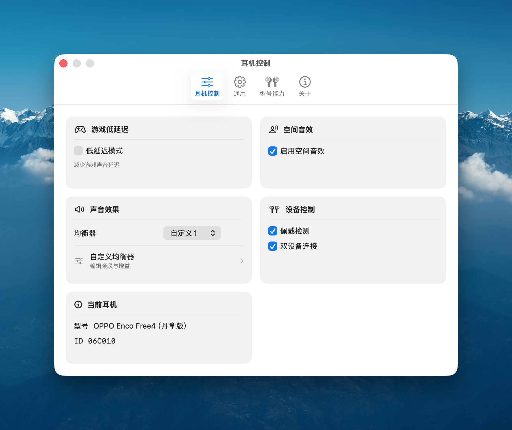

# OPPO Pods for macOS

[](#系统要求)
[](Package.swift)
[](LICENSE)

面向 macOS 的非官方 OPPO、OnePlus、realme 耳机控制工具。它使用 SwiftUI 和 IOBluetooth，通过逆向整理的 OPPO / HeyMelody RFCOMM 协议读取电量、切换降噪并控制耳机功能。

> [!WARNING]
> 本项目与 OPPO、OnePlus、realme、HeyTap 或 Apple 无关，也不是官方 HeyMelody 客户端。协议可能随耳机固件更新而变化，请先阅读[设备适配说明](docs/Supported_Devices.md)。

## 界面预览

| 菜单栏状态 | 降噪主页面 |
|:---:|:---:|
|  |  |



界面会根据耳机返回的 product ID 和型号能力自动隐藏不支持的控制项；截图为 OPPO Enco Free4（丹拿版）的实机效果。

## 当前状态

项目目前为开发预览版，采用 macOS 菜单栏应用形式：

- 主页面集中显示电量与噪声控制，不使用滚动条。
- “设置…”打开独立窗口，其他功能按类别以双列卡片显示。
- 不注入系统控制中心、`bluetoothd` 或系统设置。
- macOS 没有公开的第三方 AirPods 控制面板扩展接口，因此本项目不会伪装成 AirPods。

## 功能

- 枚举 macOS 已配对设备并保存首选耳机
- 只在耳机已连接系统蓝牙时建立厂商控制通道
- 实时监听系统蓝牙连接事件，并在启动阶段分批恢复已连接设备
- HeyMelody SDP UUID 查询与 RFCOMM channel 15 回退
- 控制通道 10 秒超时、初始化重试和定时状态刷新
- 左耳、右耳和充电盒电量及充电状态
- 降噪、关闭、通透、自适应降噪
- 游戏低延迟开关
- 空间音效开关，或型号明确支持时显示空间音频三档模式
- 内置 EQ 预设，以及设备端自定义 EQ 的读取、选择、六段或型号指定频段编辑
- 佩戴检测、双设备连接
- 根据 product ID 和型号元数据动态隐藏不适用功能

> [!NOTE]
> 自定义 EQ 使用原项目整理的 `0x0122`/`0x0418` 协议读取和写入耳机。OPPO Enco Free4（丹拿版）未在型号表声明频点时使用 62、250、1000、4000、8000、16000 Hz 六段默认值；其他型号若声明了频点则按型号数据显示。该功能仍需更多固件版本实机验证，首次使用前建议在官方 HeyMelody 软件中记录原曲线。

## 系统要求

- macOS 14 Sonoma 或更高版本
- 支持 Bluetooth Classic RFCOMM 的 Mac
- OPPO / OnePlus / realme 耳机已在“系统设置 → 蓝牙”完成普通音频配对
- 从源码构建需要 Xcode 15.3+ 和 Swift 5.10+

## 安装

1. 先在“系统设置 → 蓝牙”中配对并连接耳机。
2. 将 `OPPOPods.app` 拖入 `/Applications`（“应用程序”）文件夹。
3. 从“应用程序”、Spotlight 或 Launchpad 打开。
4. 在菜单栏 OPPOPods 中选择首选耳机。

直接双击构建目录里的 `.app` 也能运行，但相当于便携运行。更新时用新版 App 替换旧版即可；Bundle ID 保持不变，因此偏好设置通常会保留。

当前构建脚本只生成 ad-hoc 签名版本，没有 Apple 公证。从 GitHub 下载后首次打开时，可能需要在 Finder 中右键 App 并选择“打开”。

## 发布版本

推送符合 `v*` 的语义化版本标签后，GitHub Actions 会自动测试、构建 DMG、创建或更新对应的 GitHub Release，并上传 DMG 安装镜像及其 `SHA256SUMS.txt` 校验文件：

```bash
git tag v0.1.0
git push origin v0.1.0
```

DMG 内包含 `OPPOPods.app` 和“应用程序”文件夹快捷方式。当前自动发布仍使用 ad-hoc 签名；配置 Developer ID 证书和 Apple 公证凭据后，才适合面向普通用户无提示分发。

## 从源码构建

```bash
git clone <your-repository-url>
cd oppopods
swift test
./Scripts/build-app.sh
open dist/OPPOPods.app
```

也可以使用 Xcode 直接打开 `Package.swift`，运行 `OppoPodsMac` scheme。

构建脚本会：

1. 执行 Swift Release 构建。
2. 生成标准 `dist/OPPOPods.app` 目录结构。
3. 复制 `Info.plist`、应用图标、型号库和 EQ 名称表。
4. 使用蓝牙 entitlements 执行本地 ad-hoc 签名。

运行 `./Scripts/build-dmg.sh development` 可以在 `dist/` 中生成本地 DMG。

公开分发前应改用 Developer ID Application 签名，并完成 Apple 公证和 DMG 打包。

## 设备适配

`Resources/device_models.json` 目前包含 137 条 HeyMelody 型号记录：

| 分类 | 数量 |
|---|---:|
| 可尝试 SPP 的耳机 / 颈挂耳机 | 128 |
| OPPO 候选 | 51 |
| OnePlus 候选 | 31 |
| realme / DIZO 候选 | 46 |
| 明确标记 `supportSpp=false` | 6 |
| 型号库中的非耳机音箱 | 3 |

“协议候选”不等于所有功能已经实机验证。当前收到明确 macOS 实机反馈的型号是 OPPO Enco Free4（丹拿版，product ID `06C010`）。完整列表与能力字段见[设备适配列表](docs/Supported_Devices.md)。

## 工作原理

普通声音使用 macOS 已建立的 A2DP / HFP 链路；OPPOPods 另外打开厂商 RFCOMM 控制通道。软件不会主动替代系统连接耳机：如果设备尚未连接系统蓝牙，“连接控制”按钮会保持禁用。

当前优先查询两个 HeyMelody SPP UUID：

```text
00001107-D102-11E1-9B23-00025B00A5A5
0000079A-D102-11E1-9B23-00025B00A5A5
```

外层帧格式：

```text
AA [TotalLen] 00 00 [Cmd 2B LE] [Seq] [PayloadLen 2B LE] [Payload...]
```

实现包含握手、product ID、通知订阅、电量、ANC、批量状态、空间音效、EQ 和 feature 开关。研究记录见：

- [协议实现笔记](docs/Protocol_Notes.md)
- [官方客户端互操作性研究](docs/Protocol_Research.md)
- [实现计划](docs/Implementation_Plan.md)

这些文档是社区互操作性研究，不是 OPPO / HeyTap 官方协议规范。

## 项目结构

```text
.
├── AppBundle/                  Info.plist、entitlements 和应用图标
├── Resources/                  型号能力与 EQ 名称数据
├── Scripts/build-app.sh        独立 App Bundle 构建脚本
├── Sources/
│   ├── OppoPodsCore/           协议命令、封包、分帧与解析
│   └── OppoPodsMac/            SwiftUI、IOBluetooth 与会话状态
├── Tests/OppoPodsCoreTests/    协议单元测试
├── docs/                       适配表、协议研究与实现计划
├── Package.swift
├── THIRD_PARTY_NOTICES.md
└── LICENSE
```

项目没有外部 Swift Package 依赖，只使用 Swift 标准库和 macOS 系统框架 SwiftUI、AppKit、Foundation 与 IOBluetooth。

## 故障排查

### 设备显示“系统未连接”

先在 macOS“系统设置 → 蓝牙”中连接耳机。OPPOPods 监听系统蓝牙连接事件，正常情况下按钮会近实时恢复；控制服务稍晚就绪时会在连接后的数秒内分阶段重试。

### 耳机已连接，但控制页面没有出现

- 在“设置 → 通用”确认首选耳机正确。
- 保持“耳机已连接时自动建立控制通道”开启。
- 点击“刷新设备列表”。
- 同型号有多个历史配对时，从系统蓝牙中移除旧记录。

### 只有声音，没有控制能力

A2DP / HFP 音频连接和 HeyMelody RFCOMM 控制通道相互独立。某些型号、地区版本或固件即使音频正常，也可能没有开放相同的 SPP 服务。

### 功能显示不完整

功能显隐来自耳机返回的 product ID 和 `Resources/device_models.json`。请提交设备适配 Issue，并提供型号、product ID、固件版本、macOS 版本和逐项结果；不要上传蓝牙 MAC 地址或未脱敏日志。

## 开源来源

该 macOS 仓库从 [Leaf-lsgtky/OppoPods](https://github.com/Leaf-lsgtky/OppoPods) 中拆分，项目历史可追溯至 GPL-3.0 的 [Art-Chen/HyperPods](https://github.com/Art-Chen/HyperPods)。协议实现还参考了 HeyMelody 通信观察和其他社区互操作性研究。

详细来源、使用方式和许可证边界见 [THIRD_PARTY_NOTICES.md](THIRD_PARTY_NOTICES.md)。本仓库不包含官方 HeyMelody APK、耳机固件、签名密钥或用户私有抓包。

## 贡献

欢迎提交协议解析、型号测试、UI 修复和文档改进。设备报告应包含：

- 耳机完整型号、product ID 和固件版本
- Mac 型号 / 芯片及 macOS 版本
- 电量、ANC、空间音效、游戏模式、EQ、佩戴检测、双设备逐项结果
- 复现步骤与脱敏后的错误信息

## 许可证

本项目按 [GNU General Public License v3.0](LICENSE) 发布。分发源码、修改版或二进制时，请保留上游归属和第三方声明，并提供对应源码。

OPPO、OnePlus、realme、HeyTap、HeyMelody、Apple 和 macOS 是各自权利人的商标；本文仅以其说明兼容对象。

## English summary

OPPO Pods for macOS is an unofficial GPL-3.0 menu-bar controller for selected OPPO, OnePlus, and realme earbuds. It uses SwiftUI, IOBluetooth, and a reverse-engineered HeyMelody RFCOMM protocol. Read the [device matrix](docs/Supported_Devices.md) and [third-party notices](THIRD_PARTY_NOTICES.md) before testing or redistributing it.
