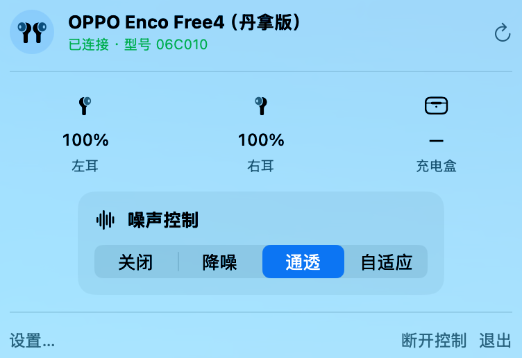

# OPPO Pods Connect

[](#系统要求)
[](Package.swift)
[](LICENSE)
[](https://github.com/ssigpoy/OPPO-Pods-for-macOS)

面向 macOS 的非官方 OPPO / OnePlus / realme 耳机控制工具（菜单栏应用）。

本项目基于 [ssigpoy/OPPO-Pods-for-macOS](https://github.com/ssigpoy/OPPO-Pods-for-macOS) 持续完善：在原有电量、降噪、EQ 等能力之上，**新增降噪深度档位、通透强化人声、双联设备列表与刘海连接弹窗**，并把设备库扩充至 141 款（含 OPPO Enco X4）。协议实现以逆向 HeyMelody 官方 App 为依据，整理在 [docs/Protocol_Notes.md](docs/Protocol_Notes.md)。

> [!WARNING]
> 本项目与 OPPO、OnePlus、realme、HeyTap 或 Apple 无关，也不是官方 HeyMelody 客户端。协议可能随耳机固件更新而变化，请先阅读[设备适配说明](docs/Supported_Devices.md)。

## 相比原项目的增强

| 方向 | 内容 |
|---|---|
| 设备适配 | 型号库 137 → 141：新增 **OPPO Enco X4**、OnePlus Buds Pro 4、Enco Buds3s、OnePlus Buds Clip；76 条升级为新版 HeyMelody 白名单元数据 |
| 降噪深度 | 主模式之外支持子档位：**智能动态 / 深度 / 中度 / 轻度**（Enco X3/X4 等机型） |
| 自适应范围 | 自适应模式三档：**更少噪音 / 标准 / 更多噪音** |
| 通透人声 | 通透模式下**强化人声**开关（按型号元数据自动显隐） |
| 双联设备 | 设置 → 耳机控制 → **双联设备**：显示耳机多点连接的设备列表与状态（`0x0112` 查询 + `0x0204` 事件） |
| 连接弹窗 | 耳机连上后在**刘海下方**弹出胶囊卡片：型号 + 左/右耳/充电盒电量，自动消失 |
| 协议修复 | 修正 `0x8112` 双联响应解析（`[status, count, …]` 格式）、查询时机等；测试 9 → 19 |
| UI 稳定性 | 修复菜单窗口高度滞留导致的边框/直角异常等显示问题 |

## 功能

- 枚举 macOS 已配对设备并保存首选耳机；系统蓝牙连接后自动建立厂商控制通道
- 左耳、右耳和充电盒电量及充电状态
- 降噪、关闭、通透、自适应降噪，含**深度档位**与**强化人声**子选项
- 游戏低延迟开关；空间音效开关或三档空间音频模式
- 内置 EQ 预设，设备端自定义 EQ 的读取、选择与多频段编辑
- 佩戴检测、双设备连接（双联设备列表）
- 连接成功时的刘海胶囊弹窗
- 根据 product ID 和型号元数据动态隐藏不适用功能

## 界面预览

| 菜单栏状态 | 降噪主页面 |
|:---:|:---:|
|  |  |

> 截图为原项目实机效果（OPPO Enco Free4 丹拿版）；新增的降噪档位、双联设备与刘海弹窗界面欢迎补充截图 / PR。

## 安装

1. 先在“系统设置 → 蓝牙”中配对并连接耳机。
2. 从 [Releases](../../releases) 下载 DMG（或自行构建），把 `OPPOPods.app` 拖入「应用程序」。
3. 打开 App，在菜单栏 OPPOPods 中选择首选耳机并「连接控制」。

构建产物为 ad-hoc 签名、无 Apple 公证：首次打开若被拦截，请在 Finder 中右键 App 选择“打开”。

## 从源码构建

需要 Xcode 15.3+ 与 Swift 5.10+：

```bash
git clone <this-repository-url>
cd OPPO-Pods-Connect
swift test
./Scripts/build-app.sh        # 产出 dist/OPPOPods.app
./Scripts/build-dmg.sh        # 产出 DMG 安装镜像
```

> [!TIP]
> 若 `swift build` 报 `SwiftUIMacros ... plugin not found`，说明命令行工具指向了 CLT 而非完整 Xcode。
> 临时指定：`export DEVELOPER_DIR=/Applications/Xcode.app/Contents/Developer`，或 `sudo xcode-select -s /Applications/Xcode.app/Contents/Developer`。

## 协议与逆向说明

控制通道走 HeyMelody RFCOMM（SDP UUID `00001107-D102-…` / `0000079A-D102-…`），数据帧为
`AA + 长度 + 00 00 + cmd(2B LE) + seq + len(2B LE) + payload`，响应 `cmd | 0x8000`。

- [docs/Protocol_Notes.md](docs/Protocol_Notes.md)：帧格式、命令表、双联命令（`0x0112`/`0x429`）、降噪子档位语义、白名单 AES-GCM 解密配方
- [docs/Protocol_Research.md](docs/Protocol_Research.md)：通知机制与抓包线索
- [docs/Supported_Devices.md](docs/Supported_Devices.md)：141 款型号库与能力分级

## 致谢

- [ssigpoy/OPPO-Pods-for-macOS](https://github.com/ssigpoy/OPPO-Pods-for-macOS) —— 本项目的原作，提供了完整的 macOS 客户端架构与协议逆向基础。本仓库在其之上继续完善，欢迎把有价值的修复以 PR 形式回馈上游。
- 协议逆向来自对 OPPO / HeyMelody 官方 App 的公开可得产物分析，仅用于互操作性研究。

## License

[GPL-3.0](LICENSE)，与上游项目保持一致。
